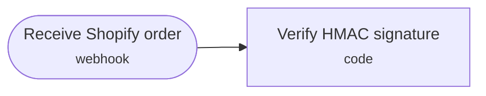

# n8n workflow docs

The script produces the factual skeleton (structure, triggers, diagram, credentials);
you add the purpose, business rules and operating notes that only humans know.

Paths below are relative to this skill's folder (in Claude Code: `${CLAUDE_SKILL_DIR}`).

## When to use

- "Document my n8n workflows", "write a README for this automation"
- "Explain what this workflow does" (start from the generated summary and diagram)
- Client handover, audits, onboarding a teammate
- Keeping `docs/` in sync with exported workflows in git (CI regenerates them)

## When not to use

- Finding problems in the workflow: `n8n-workflow-lint` (run it too and link the result)
- Designing a new workflow: `n8n-workflow-design` (the plan is the doc until it is built)

## Workflow

1. **Get the exports** (editor Download, or on the server
   `n8n export:workflow --all --separate --output=workflows/`). Unpin test data first if the
   docs will be shared; pinned data is not rendered, but the JSON files may travel with the docs.
2. **Generate** (read-only on the input):
   ```bash
   python3 scripts/workflow_docs.py wf.json                    # Markdown to stdout
   python3 scripts/workflow_docs.py workflows/ --out docs/workflows   # one .md each + README.md index
   python3 scripts/workflow_docs.py wf.json --mermaid-only     # just the diagram
   python3 scripts/workflow_docs.py workflows/ --json          # structure for further processing
   ```
3. **Add the human part** at the top of each generated file (or in a separate
   `docs/workflows/<name>.notes.md` so regeneration does not overwrite it):
   - Purpose: one paragraph, in business terms ("Creates a HubSpot deal for every paid Shopify order")
   - Owner and on-call contact
   - Inputs and outputs (systems, data, volumes), SLAs
   - Failure handling: where alerts go, how to replay (link `n8n-error-handling` patterns)
   - Runbook: how to pause, re-run, rotate credentials
   Ask the user for facts you cannot infer; do not invent owners or SLAs.
4. **Check the diagram renders** (GitHub preview or https://mermaid.live). Large
   workflows (40+ nodes) are easier to read when you also describe the main path in
   numbered steps.
5. **Keep it current**: regenerate after each export; in CI, regenerate and fail if
   `git diff --exit-code docs/workflows` shows changes nobody committed.

## Output

A generated file looks like:

````markdown
# Shopify: order created
| | |
| --- | --- |
| Status | active |
| Error workflow | `wf-error-handler` |

## Triggers
- **Receive Shopify order** (webhook): POST `/webhook/6f1c...`, auth: none, respond: responseNode

## Flow


## Nodes
| # | Node | Type | Notes |
| 1 | Receive Shopify order | `webhook` | |
| 5 | Fetch order details | `httpRequest` | retry x3; credential: Shopify admin |

## Credentials
- `shopifyAccessTokenApi`: Shopify admin (used by Fetch order details)
````

When explaining a workflow in chat, give the purpose in two sentences, then the main path
as numbered steps, then the diagram.
